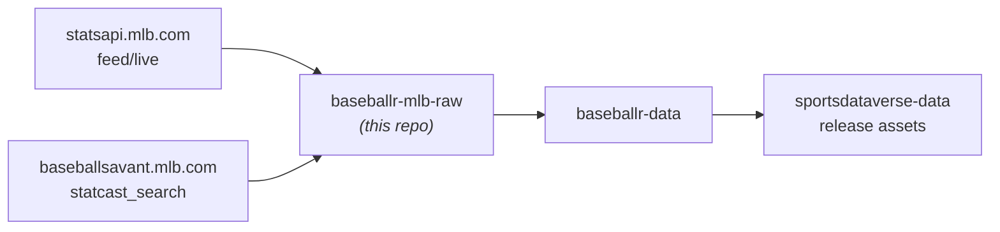
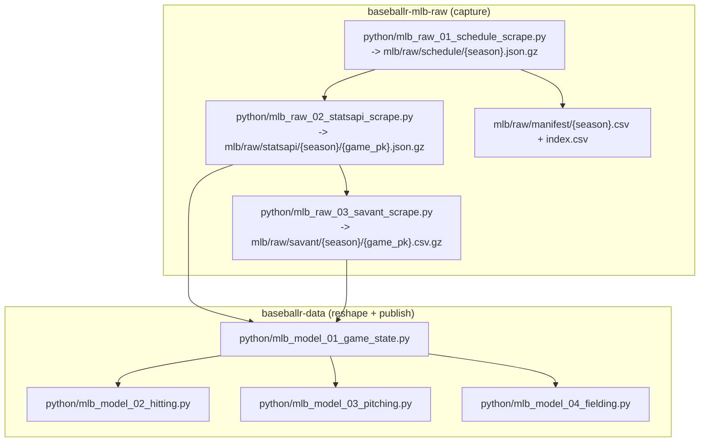

# baseballr-mlb-raw

Raw MLB capture for the SportsDataverse baseball stack. Two per-game surfaces —
the **MLB Stats API** `feed/live` payload and the **Baseball Savant** per-game
Statcast export — committed as gzipped files, one per game, plus a per-season
schedule and manifest.

This repo is **scraping-only**. It fetches, validates, and commits payloads. It
does no reshaping, no modeling, and publishes no release assets — that is
[`baseballr-data`](https://github.com/sportsdataverse/baseballr-data)'s job.

## Where this sits





Stage 01 must run before 02/03: the schedule is what enumerates `game_pk`s, and
the manifest it writes is the work list both capture stages filter.

## Reading it without cloning

The tree is ~465 MB, so a consumer should read per-game files over HTTP rather
than clone.

**`mlb/raw/manifest/{season}.csv` is the source of truth for what exists** — one
row per scheduled game, with `statsapi_path` / `savant_path` filled in only for
games that were actually captured, alongside `*_bytes` and a `*_sha256` per file
so a consumer can verify what it downloaded. Fetch only the rows that carry a
path.

**Do not derive URLs from the schedule.** The schedule lists every scheduled
game — 2,959 in 2024 — while 2,472 were captured; spring training, exhibitions
and non-final games are deliberately out of scope, so building a URL per
scheduled game produces ~487 requests that 404 by design.

```
mlb/raw/manifest/index.csv          one row per season -- read this first, to discover seasons
mlb/raw/manifest/{season}.csv       one row per game   -- the per-game contract, paths + sha256
mlb/raw/schedule/{season}.json.gz   the raw schedule feed, for reference
```

Paths in the manifest are relative to `mlb/raw/`, so a full URL is the raw base
plus the path:

```
https://raw.githubusercontent.com/sportsdataverse/baseballr-mlb-raw/main/mlb/raw/<statsapi_path>
https://raw.githubusercontent.com/sportsdataverse/baseballr-mlb-raw/main/mlb/raw/<savant_path>
```

e.g. `statsapi/2024/745444.json.gz` and `savant/2024/745444.csv.gz`.

## Coverage

| season | scheduled | captured (statsapi) | captured (savant) | statsapi bytes | savant bytes |
|---|---:|---:|---:|---:|---:|
| 2024 | 2,959 | 2,472 | 2,472 | 325,457,984 | 147,877,879 |

Scheduled counts every game on the schedule feed including spring training
(`S`: 472) and exhibitions (`E`: 13, `A`: 1); captured counts **completed**
regular-season and postseason games (`R`, `D`, `L`, `W`, `F`), which is what the
stages filter to. The gap is not loss.

2024 is the proof season. Earlier seasons backfill into this same tree.

## Running a capture

See [`RUNBOOK.md`](RUNBOOK.md) for the full operator guide. The short form:

```sh
bash scripts/run_mlb_01_schedule_scrape.sh --season 2024
bash scripts/run_mlb_02_statsapi_scrape.sh --season 2024
bash scripts/run_mlb_03_savant_scrape.sh   --season 2024
```

Every stage is **resumable and idempotent**. Resume is presence-based: a game is
outstanding when its file is missing or too small on disk, so an interrupted run
is restarted by re-running the same command — there is no checkpoint file to
corrupt and no flag to remember. Re-capturing an unchanged payload rewrites it to
byte-identical content (gzip is stamped with `mtime=0` and an empty filename
field), so a redundant run is a git no-op rather than a churn commit.

`--limit N` caps a run at N games; `--root` (or `$SDV_MLB_RAW_ROOT`) points the
same code at a different capture tree.

## Design notes

[`docs/mlb-raw-layer.md`](docs/mlb-raw-layer.md) covers the capture contract in
full: the validators and why each floor is set where it is, the manifest schema,
the Savant 25,000-row cap and the headroom measurement behind it, and the
reshape contract `baseballr-data` reads.

## Automation & status

No scheduled workflow yet — captures are operator-run from `RUNBOOK.md` while the
backfill is in progress. CI runs the offline test gate on every push and PR:

[](https://github.com/sportsdataverse/baseballr-mlb-raw/actions/workflows/tests.yml)

| workflow | trigger | what it gates |
|---|---|---|
| `tests.yml` | push to `main`, PR, manual | pytest (offline), ruff, `bash -n` over `scripts/` |

This repo publishes **no release assets**; its output is the committed tree.
